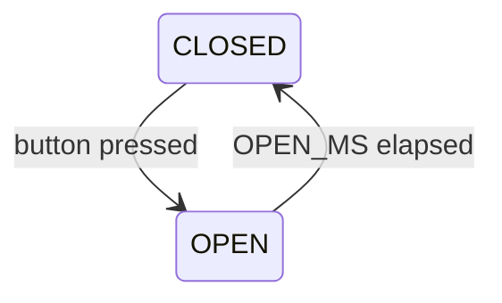

# 09 — Servo Barrier Gate

A miniature parking barrier: press a button → gate rises → lowers itself
after a few seconds. The first project built as a real **state machine**.

## Real-world problem

Parking barriers open on request and auto-close on a timer — while
staying responsive (safety sensors can always interrupt). The old version
of this sketch used `delay(4000)`: during those 4 s the board was dead —
no second button, no sensor, nothing. Real systems can't work like that.

## Learning objectives

- Drive a hobby servo (`Servo` library, `write(angle)`)
- Detect a button *press* with debounce — once, not continuously
- Model behavior as states (`CLOSED`/`OPEN`) with `millis()` timing
- See why `delay()` breaks multi-tasking and how to avoid it

## Prerequisites

Project 03 (buttons + pull-ups), 06 (non-blocking timers).

## Components

| Qty | Component | Notes |
|----:|-----------|-------|
| 1 | Arduino Uno | |
| 1 | Micro Servo SG90 | Signal wire to D9 |
| 1 | Push button | INPUT_PULLUP, active-LOW |

## Wiring

```
Servo          Arduino
-----          -------
Signal     --> D9
VCC        --> 5V
GND        --> GND

Button between D2 and GND (internal pull-up)
```

| Signal | Pin |
|--------|-----|
| Servo signal | **D9** |
| Button | **D2** |

> Servo power: an SG90 idles fine on USB 5 V for a desktop demo, but stall
> current can brown-out the board. For anything beyond a light demo,
> power the servo separately (and share grounds).

## How it works

1. `buttonPressed()` implements textbook debounce: it tracks the raw
   input, accepts a change only after it stays stable `DEBOUNCE_MS`, and
   returns `true` **once** on each falling edge.
2. `loop()` is a 2-state machine:
   - `CLOSED`: a press → servo to `OPEN_ANGLE`, record time, go `OPEN`.
   - `OPEN`: when `millis() − openedAt ≥ OPEN_MS` → servo to
     `CLOSED_ANGLE`, back to `CLOSED`.
3. The board never sleeps — loop() runs thousands of times per second;
   the servo only moves on state transitions.

## The algorithm

```
state CLOSED: on debounced press → write(OPEN_ANGLE), openedAt = now → OPEN
state OPEN:   now − openedAt ≥ OPEN_MS → write(CLOSED_ANGLE) → CLOSED
```



## Upload & test

1. Upload `servo-barrier.ino`, Serial at 9600 (optional).
2. Arm starts low (closed). Press → rises, prints `OPEN`.
3. ~4 s later → lowers, prints `CLOSED`.
4. Press *while open* → ignored (state is OPEN) — clean, predictable.

## Troubleshooting

| Symptom | Likely cause |
|---|---|
| Servo jitters/twitches | Power sag on USB — add a capacitor or separate 5 V supply |
| One press opens it repeatedly | Debounce removed/broken — check `stableButton` logic |
| Gate opens the wrong way | Servo horn orientation — swap `OPEN_ANGLE`/`CLOSED_ANGLE` |
| Nothing on press | Button wired to 5V instead of GND, or wrong pin |

## Challenges

- **Beginner:** add a red/green LED pair — green while OPEN, red while CLOSED.
- **Intermediate:** add a second "close now" button on D3 — trivial now that it's a state machine (this is the payoff).
- **Advanced:** smooth motion — step the servo 1° every 15 ms instead of jumping 0°→90°.

## Knowledge check

1. Why did `delay(4000)` make the old version unresponsive?
2. `buttonPressed()` returns `true` once per press — what two variables make that possible?
3. In the OPEN state, why is a button press ignored — feature or bug?
4. What happens to `millis() - openedAt` when `millis()` wraps around after ~49 days, and why does the `unsigned long` subtraction still work?

## Safety notes

- Don't hold a servo against its end stop for long — it heats up and wears out.
- Keep fingers out of the horn's arc while powered.
