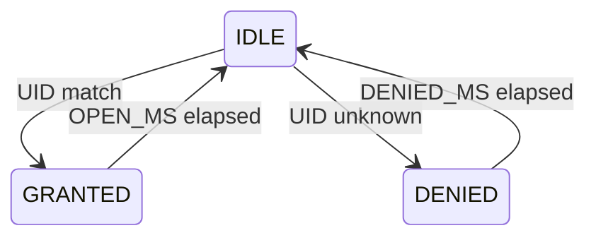

# 11 — Smart Door Lock (RFID + LCD + Servo)

The capstone: an RC522 card reader, LCD status display, and servo
"lock" — full grant/deny flow with a 3-state machine.

## Real-world problem

A door lock merges an RFID reader (project 10), a status display, and an
actuator. It must show IDLE → GRANTED/DENIED → back to IDLE, keep timing
non-blocking, and survive the course's first real **pin conflict**: the
LCD and RC522 both wanted the SPI pins.

## Learning objectives

- Combine three peripherals: SPI RC522, parallel LCD, and a servo
- Resolve a **bus conflict** — move the LCD off D11/D12 so SPI stays free
- Model the whole system as `IDLE → GRANTED|DENIED → IDLE`
- Separate state transitions from the timed actions that own them

## Prerequisites

Project 10 (RFID + SPI + non-blocking timing). LCD basics help.

## Components

| Qty | Component | Notes |
|----:|-----------|-------|
| 1 | Arduino Uno | |
| 1 | RFID-RC522 + card | 3.3 V, SPI |
| 1 | LCD 1602 + 10 kΩ pot (contrast) | |
| 1 | Micro Servo SG90 | Lock bolt |
| 2 | LEDs + resistors | Grant (green) / deny (red) — optional |

## Wiring

```
RC522               Arduino           LCD               Arduino
-----               -------           ---               -------
SDA (SS)        --> D10               RS            --> A2      ← moved off D12!
SCK             --> D13               E             --> A3      ← moved off D11!
MOSI            --> D11               D4–D7         --> D4 D5 D6 D7
MISO            --> D12               VSS,RW,K      --> GND
RST             --> D9                VDD,A         --> 5V
3.3V            --> 3.3V              VO            --> pot wiper
GND             --> GND               pot ends      --> 5V / GND

Servo:  signal --> D8,  VCC --> 5V,  GND --> GND
LEDs:   D2 = grant (green), D3 = deny (red), each through 220 Ω
```

| Signal | Pin | Note |
|--------|-----|------|
| RC522 SS/SCK/MOSI/MISO | D10/13/11/12 | SPI bus |
| RC522 RST | D9 | |
| LCD RS / E | **A2 / A3** | **freed from SPI pins** |
| LCD D4–D7 | D4–D7 | |
| Servo / grant / deny | D8 / D2 / D3 | |

> **Why the LCD moved:** RS/E sat on D12/D11 = SPI MISO/MOSI. Two
> outputs driving the same pins corrupts every SPI transfer. The LCD
> is a plain digital part — it works fine on the analog pins (A2/A3 are
> just GPIOs here).

## Libraries

**MFRC522** (1.4.12+), **Servo**, **LiquidCrystal** — see `platformio.ini`.

## How it works

```
State machine (non-blocking — no delay() anywhere):

  IDLE:    card? → read UID → GRANTED or DENIED (timestamp + feedback)
  GRANTED: OPEN_MS elapsed → servo to locked, LED off → IDLE
  DENIED:  DENIED_MS elapsed → LED off, LCD back to idle → IDLE
```



Transitions happen on card tap; the *exit* from GRANTED/DENIED is pure
`millis()` timing — the loop spins freely between events.

## Upload & test

1. Upload `smart-door-lock.ino`, Serial at 9600.
2. LCD shows `SMART DOOR LOCK` / `Tap your card`. Adjust the contrast
   pot until text is crisp.
3. Tap an unknown card → `ACCESS DENIED` + red LED ~1.5 s → back to idle.
4. Copy its UID from Serial into `ALLOWED_UID`, re-upload, tap →
   `ACCESS GRANTED`, servo swings open for `OPEN_MS`, then re-locks.

## Troubleshooting

| Symptom | Likely cause |
|---|---|
| LCD blank / blocks | Contrast pot — turn it; or VDD/RW unwired |
| `firmware version: 0x0` | RC522 on 5 V or SPI wiring wrong — remember 3.3 V |
| LCD garbage while RFID works | RS/E still on SPI pins — check the **A2/A3** change made it to hardware |
| Servo twitches at boot | Servo attach pulse — normal; make sure `LOCKED_ANGLE` matches your horn |
| Reads card once then dead | `PICC_HaltA`/`StopCrypto1` removed — restore them |

## Challenges

- **Beginner:** add a third card to `ALLOWED_UID` as a "guest" (array loop from project 10).
- **Intermediate:** show `CARD: xx xx xx xx` on the LCD on every tap — but only during a new state, not spamming.
- **Advanced:** two-line log — keep the last event on line 2 permanently, current state on line 1.

## Knowledge check

1. Why couldn't the LCD keep RS on D12 and E on D11? Name the two peripherals that collide.
2. `PIN_LCD_RS = A2` — why is an "analog" pin fine for a digital LCD signal?
3. In `DENIED`, who owns the timer that returns to IDLE — the transition or `loop()`?
4. Why is the servo re-locked by a timeout in `GRANTED` rather than by reading the card again?

## Safety notes

> **Not a real lock.** Everything from project 10 applies: the UID is
> clonable, the "key" lives in the firmware, and a SG90 is a demo bolt —
> anyone can overpower it. Treat this as the *shape* of a real system,
> not the security of one. Also: never power the servo from the Uno's
> 5 V rail long-term — a stalled SG90 can brown-out the whole board.
