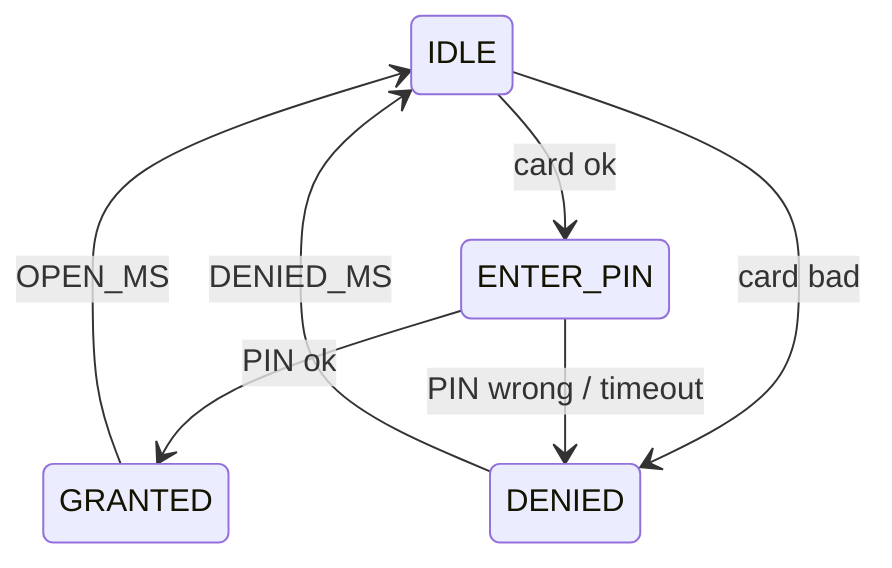

# 11 — Smart Door Lock (RFID + IR PIN + LCD + Servo)

The capstone: tap a registered card → type a 4-digit PIN **on the IR
remote** → servo swings the bolt open. LCD shows status, the ring
shows the verdict. Two factors (something you *have* + something you
*know*) — like real locks.

## Real-world problem

Real door locks layer an RFID badge with a PIN pad. This kit has no
keypad — but the 20-key IR remote *has* digit buttons. This project
is the full integration: SPI card reader, parallel LCD, servo, ring,
buzzer, IR — one state machine holding it all together, with the
**SPI-vs-LCD pin conflict** as the key debugging lesson.

## Learning objectives

- Two-factor flow: card (`have`) → PIN (`know`) → grant
- Keep the LCD off the SPI pins — the A2/A3 fix, in context
- `IDLE → ENTER_PIN → GRANTED|DENIED → IDLE` state machine
- Timeouts on *every* state — the lock can't get stuck

## Prerequisites

Project 10 (RFID + state machine). LCD, servo, IR, ring all combine here.

## Components

| Qty | Component | Notes |
|----:|-----------|-------|
| 1 | Arduino Uno | |
| 1 | RC522 + card | 3.3 V, SPI |
| 1 | LCD 1602 + 10 kΩ pot | Contrast |
| 1 | SG90 servo | Bolt |
| 1 | 12-LED NeoPixel ring | Status |
| 1 | 1838T IR receiver + remote | PIN entry |
| 1 | Active buzzer | Beeps |
| 1 | 220 Ω resistor | Ring DIN |

## Wiring

```
RC522            Arduino        LCD              Arduino
-----            -------        ---              -------
SS           --> D10            RS           --> A2     ← off SPI!
SCK          --> D13            E            --> A3     ← off SPI!
MOSI         --> D11            D4–D7        --> D4–D7
MISO         --> D12            VSS,RW,K     --> GND
RST          --> D9             VDD,A        --> 5V
3.3V         --> 3.3V           VO           --> pot wiper
GND          --> GND            pot ends     --> 5V/GND

Servo → D8     Ring DIN → D2     IR out → A1     Buzzer → A0
```

| Signal | Pin | Note |
|--------|-----|------|
| RC522 SS / RST | D10 / D9 | |
| SPI SCK/MOSI/MISO | D13/11/12 | bus — nothing else here |
| LCD RS / E | **A2 / A3** | moved off D11/D12 |
| LCD D4–D7 | D4–D7 | |
| Servo / Ring / IR / Buzzer | D8 / D2 / A1 / A0 | |

## Libraries

**MFRC522**, **Servo**, **LiquidCrystal**, **IRremote** (4.x),
**Adafruit_NeoPixel** — `platformio.ini`.

## How it works

```
IDLE:      "Tap your card" → card? → uid ok → ENTER_PIN / else DENIED
ENTER_PIN: LCD masks typed digits → 4 in → check → GRANTED / DENIED
           (10 s timeout → DENIED — can't get stuck waiting)
GRANTED:   servo open, ring green, LCD "Welcome" → OPEN_MS → relock → IDLE
DENIED:    ring red, buzzer, LCD "Denied" → DENIED_MS → IDLE
```



Every transition is a `millis()` timestamp — `loop()` spins free.

## Upload & test

1. Upload `smart-door-lock.ino`, Serial at 9600.
2. LCD: `SMART DOOR LOCK` / `Tap your card` (adjust contrast pot).
3. Tap an unknown card → `DENIED` + red + buzzer. Copy its UID from
   Serial into `ALLOWED_UID`, re-upload.
4. Press remote digits — Serial prints `IR cmd=0xNN`. If your remote's
   codes differ, fix `CMD_DIGIT[]`.
5. Tap card → `Card OK — PIN:` → type `1234` → servo opens, ring green,
   `ACCESS GRANTED`. Wrong PIN → `DENIED`. Wait 10 s → auto-denied.

## Troubleshooting

| Symptom | Likely cause |
|---|---|
| LCD blank / boxes | Contrast pot; or VDD/RW unwired |
| `RC522 firmware: 0x0` | RC522 on 5 V or SPI wires wrong |
| LCD garbage while RFID works | RS/E still on SPI pins — check the **A2/A3** move |
| Remote digits do nothing | Codes differ — read `IR cmd=` on Serial, fix `CMD_DIGIT[]` |
| Grants then never locks | `GRANTED` → `IDLE` timer deleted — restore it |
| PIN never registers | `IS_REPEAT` frames unfiltered or IR pin wrong (A1) |

## Challenges

- **Beginner:** change the PIN (and its length — the `< 4` cap too).
- **Intermediate:** 3-wrong-PIN lockout (new state, timed release).
- **Advanced:** `*` on the remote = backspace during PIN entry.

## Knowledge check

1. Why are LCD RS/E on A2/A3 instead of D11/D12 — name the two peripherals that collide.
2. Why does `ENTER_PIN` need its own timeout — what failure does it prevent?
3. Which line would break if `GRANTED`'s `millis()` exit were a `delay(4000)` instead?
4. Two-factor auth: what does the card provide vs the PIN, and why is *neither* enough alone for real security?

## Safety notes

> **Not a real lock.** Everything from project 10 applies — clonable
> UID, plaintext PIN in firmware, an SG90 isn't a bolt. Also: the IR
> PIN is visible to anyone in the room — real PIN pads don't broadcast.
> Treat this as the *shape* of a real system.
